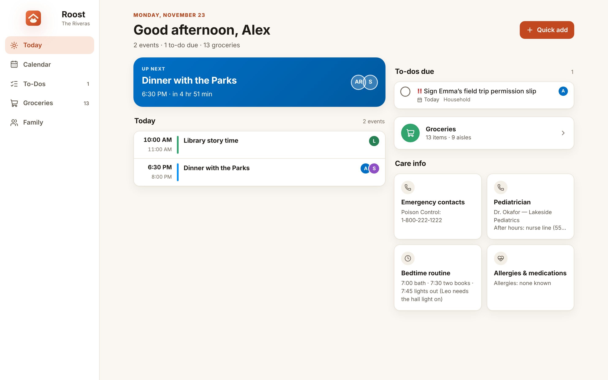
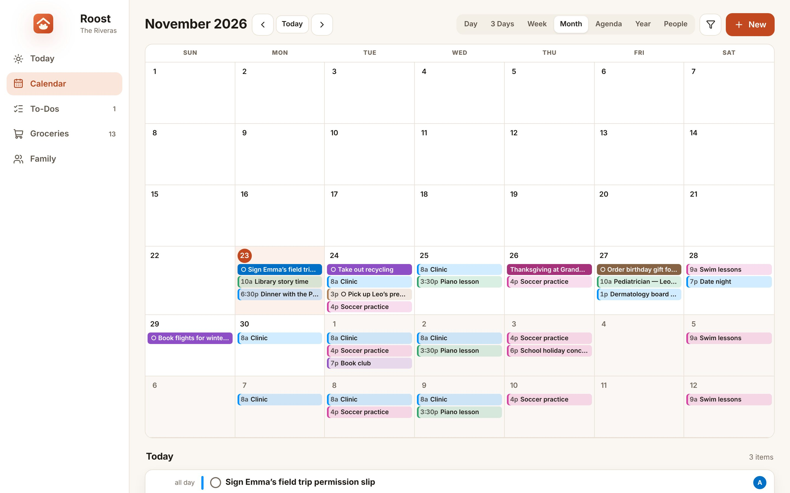
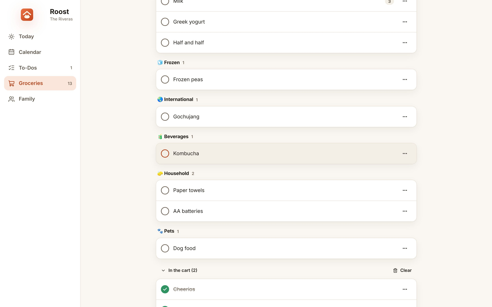
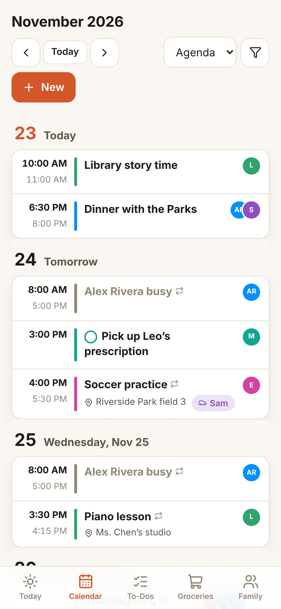
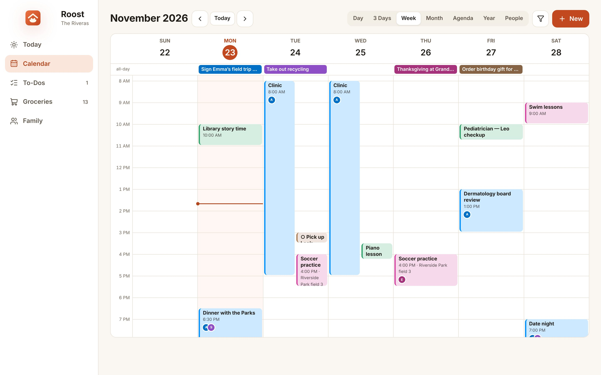
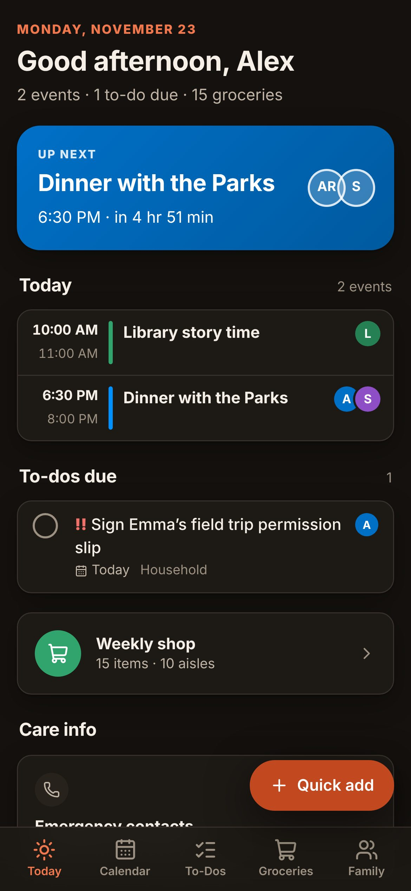

# Roost — a private family organizer

One shared calendar that talks to Outlook, Gmail and iCloud; smart to-do and grocery lists; reminders; and a care-info vault — with **role-level access** so the nanny, grandparents and kids each see exactly the right slice.

Built for one household, self-hosted, open source end to end. Native **iPhone app** (SwiftUI) + **web app** at an unlisted path, both backed by a single small Go server.

| Today | Calendar (month) | Groceries (auto-sorted by aisle) |
|---|---|---|
|  |  |  |

| Nanny's phone: parents show as “busy” | Week | Dark mode |
|---|---|---|
|  |  |  |

iPhone screenshots from the Simulator are in [`docs/screenshots/ios/`](docs/screenshots/ios/).

## What it does

**Calendar** — Day, 3-Day, Week, Month, Agenda, Year and **People** (a column per family member) views. Color by person or calendar, filters, recurring events (with “this / this and following / all” edits), **who's driving**, locations, links, private events, multiple reminders. Plain-English quick add: `Soccer every Tue 4-5:30pm @Emma driver:Sam remind 30m`, `Book club every first tuesday 7pm`.

**Connections** — iPhone shows your phone's Outlook/Exchange, Gmail and iCloud calendars alongside the family's (two-way, nothing uploaded) and can copy family events into them. Subscribe the whole family to Google/Outlook/school/team ICS feeds. Give everyone a personal feed to add Roost to Google, Outlook or Apple Calendar.

**To-dos** — lists, smart lists (Today, Upcoming, Assigned to me, Overdue, Priority), due dates and times, assignees, priority, subtasks, repeat, reminders, quick add (`Call pediatrician tomorrow 9am @Me !!`).

**Groceries** — type or paste a whole list; lines are parsed (`2 lbs chicken breast`, `milk x2`, `½ dozen eggs`), sorted into 20 aisles by a 2,374-term dictionary with head-noun matching (“chicken broth” → Pantry, “ice cream” → Frozen), duplicates merge, corrections are learned for the whole household, aisles follow **your store's order**, and “buy again” suggestions. Unknown items go to Apple's on-device model (iOS 26+) or your own local LLM.

**Roles** — Owner, Parent, Caregiver, Relative (grandparents, aunts & uncles), Kid; kids can be profiles without logins. Every calendar, list and care card can be fine-tuned per role and per person, including **Busy-only** visibility. Enforced on the server.

**Care info** — pediatrician, allergies, bedtime routine, Wi-Fi… with tap-to-call and maps, pinned to Today.

**Works offline** — every change is saved locally first and synced through an outbox that survives restarts, expired sign-ins and a rebooting home server; only the fields you changed are sent, so two people editing at once don't overwrite each other. Realtime updates when online.

**AI assistants (MCP)** — each person can create a key (Family → Settings) that lets Claude, Claude Code or an agent on your home lab read the calendar and add events, to-dos and groceries over the Model Context Protocol, with exactly that person's access. Keys are hashed at rest and revocable.

## Layout

```
roost/
├── docs/          RESEARCH.md · DESIGN.md (spec) · DEPLOY.md (start here to deploy) · screenshots/
├── shared/        grocery taxonomy + cross-language test fixtures + algorithm spec (README.md)
├── server/        Go: PocketBase v0.40 + Roost schema, access rules, hooks, ICS import/export
├── web/           React + TypeScript PWA (src/core mirrors RoostKit), Vitest + Playwright E2E
├── ios/           XcodeGen project, SwiftUI app (Roost/), RoostKit Swift package, fastlane
├── deploy/        env example, Caddyfile, systemd unit, web-path generator
├── Dockerfile     one image: server + web app
└── docker-compose.yml   (+ optional Cloudflare Tunnel profile)
```

## Develop & test

```bash
# Server (Go 1.27)
cd server && go test ./...            # role-by-role HTTP integration tests, ICS, web serving
go run . serve                        # http://127.0.0.1:8090

# Web (Node 22)
cd web && npm ci && npm test          # 247 fixture tests
ROOST_API=http://127.0.0.1:8090 npm run dev
tests/run-e2e.sh                      # builds everything, drives owner/nanny/grandma flows in Chromium

# RoostKit (Swift 6, Linux or macOS)
cd ios/RoostKit && swift test
ROOST_TEST_SERVER=http://127.0.0.1:8090 swift test   # + live round-trip against a fresh server

# iOS app (macOS + Xcode 26)
cd ios && xcodegen && open Roost.xcodeproj
```

CI (`.github/workflows/roost-ios.yml`) builds the iOS app on a GitHub macOS runner, runs RoostKit tests, and captures Simulator screenshots of a demo family. It only runs for this branch and never touches the Aurora image build.

**One spec, three implementations.** Recurrence (RFC 5545 subset, DST-safe), grocery parsing/categorization, quick-add parsing, day layout, access levels and task recurrence are implemented in Swift and TypeScript (access also in Go) and verified against the same JSON fixtures in `shared/fixtures/`; recurrence fixtures are generated from python-dateutil as an independent reference.

## Status

| Area | State |
|---|---|
| Server | Complete; `go test -race` passes (roles end-to-end over HTTP, hardening, MCP, ICS, recurrence fixtures) |
| Web app | Complete; 255 unit tests + Playwright E2E (owner, nanny, grandma, realtime, MCP, edits) pass, no console errors |
| iOS app | Complete; builds clean on Xcode 26 in CI with Simulator screenshots. **Not yet run on a physical device** — please smoke-test on your iPhone. |
| Reviews | An independent code/security review (25 findings) and a UX/accessibility review (17 findings) were run; all findings are addressed — see `docs/REVIEW.md` |
| Deploy | Docker/compose/Caddy/systemd/fastlane ready; needs your server, Apple team ID and bundle ID |
| Phase 2 (designed in DESIGN.md §11) | Direct Google/Microsoft OAuth two-way sync, APNs server push, widgets, Live Activities, meal planning |

Licensed MIT, like the rest of this repository.
